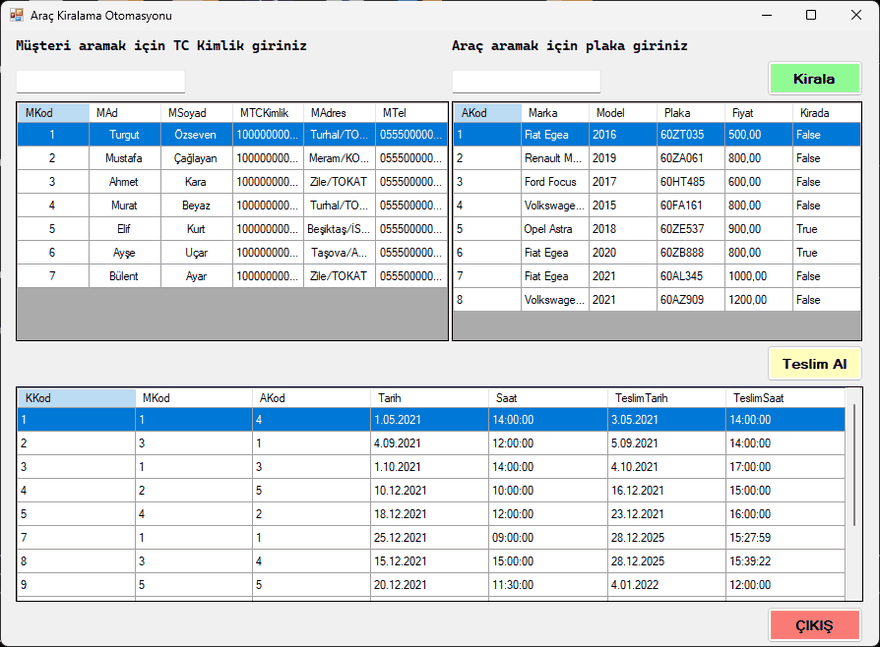
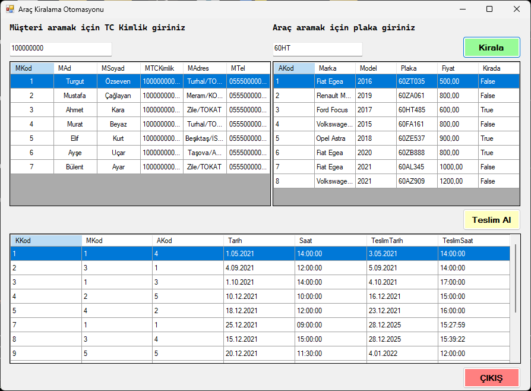

# 🚗 Araç Kiralama Otomasyonu


Müşteriye araç kiralama ve aracı teslim alma işlemlerini yapan Windows Forms uygulaması. Tüm işlemler **SQL Server stored procedure**'leri ile yapılır; uygulama bunları Entity Framework üzerinden çağırır.

> Veri Tabanı dersinde stored procedure kullanımını pekiştirmek için hazırladığım uygulamadır. Arayüz, aynı dönemde yazdığım Kütüphane Otomasyonu'nun ekranı temel alınarak oluşturulmuştur.

---

## 🎬 Demo



Müşteri TC ile, araç plakayla aranıp seçiliyor; **Kirala** ile kiralama kaydı oluşuyor ve aracın durumu "Kirada" oluyor.

| Kiralama sonrası araç durumu |
| --- |
|  |

> Görüntüler, depodaki kurulum script'iyle kurulan örnek veritabanı üzerinde uygulama çalıştırılarak alınmıştır.


## 🚀 Özellikler

- **Müşteri listesi** ve TC Kimlik ile anlık arama (`spTCFiltre`)
- **Araç listesi** (marka, model, plaka, günlük fiyat, kirada mı?) ve plaka ile arama (`spPlakaFiltre`)
- **Kirala:** Seçili araç seçili müşteriye verilir, kiralama kaydı açılır ve araç "kirada" olarak işaretlenir (`spAracTeslimEt`). Zaten kirada olan araç tekrar kiralanamaz.
- **Teslim Al:** Alttaki listeden seçilen kiralama kaydı kapatılır, teslim tarihi/saati yazılır ve araç boşa çıkar (`spAracTeslimAl`)
- Kiralama geçmişi: kiralama ve teslim tarih/saatleri

## 🗄️ Veritabanı (`KIRALAMA`)

| Nesne | Açıklama |
| --- | --- |
| `MUSTERI`, `ARAC`, `KIRA` | Müşteriler, araçlar ve kiralama hareketleri |
| `sp_Mgetir`, `sp_Agetir`, `sp_Kirala` | Listeleme |
| `spAracTeslimEt` | `INSERT` + `UPDATE` ile kiralama başlatma |
| `spAracTeslimAl` | Kiralama kaydını kapatma, aracı boşa çıkarma |
| `spTCFiltre`, `spPlakaFiltre` | `LIKE` ile arama |

---

## ⚙️ Kurulum

**Gereksinimler:** Visual Studio 2022/2026 (*.NET masaüstü geliştirme*) · SQL Server (Express yeterli) · SQL Server Management Studio (SSMS) 22

1. **İndirin**
   ```bash
   git clone https://github.com/GencayCeliker/Arac-Kiralama-Otomasyonu.git
   ```
2. **Veritabanını kurun (SSMS 22):** `Veri Tabanı/KIRALAMA.sql` dosyasını açıp **Execute (F5)**'e basın.
3. **Bağlantıyı kontrol edin:** `deneme/App.config` içindeki `KIRALAMAEntities1` bağlantısı `data source=.\SQLEXPRESS` kullanır.
4. **Çalıştırın:** `deneme.slnx` dosyasını açın; NuGet paketleri otomatik yüklenir; **F5** ile başlatın.

**Kullanım:** Müşteri ve araç listesinden birer satıra tıklayıp **Kirala**'ya basın. Teslim almak için alttaki kiralama listesinden kaydı seçip **Teslim Al**'a basın.

> Proje klasörünün adı (`deneme`) geliştirme sırasında verilen addır. Örnek verilerdeki TC Kimlik ve telefon numaraları gerçek değildir.

## 📄 Lisans

Bu proje [MIT](LICENSE) lisansı altında sunulmuştur.
